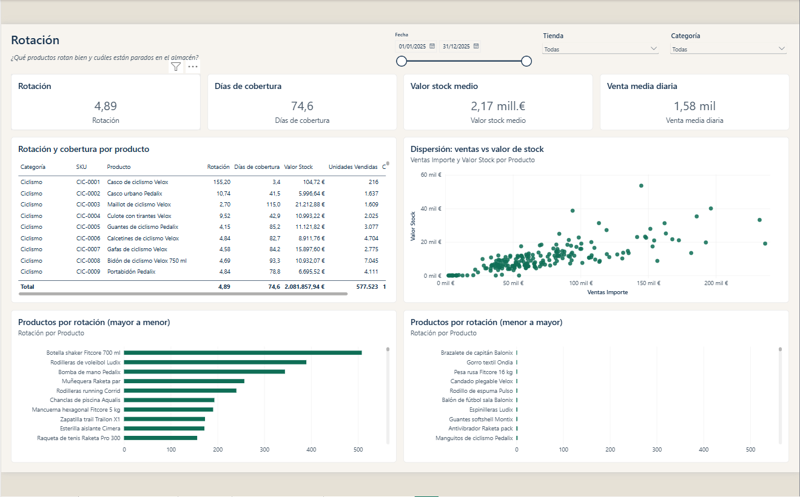

# SportStock · Analítica de stock retail

Análisis completo del stock de una cadena de tiendas deportivas ficticia, SportStock, durante 2025: rotación, cobertura, roturas y sobrestock. Va de punta a punta: generación de datos en Python, KPIs en SQL sobre SQLite y un modelo semántico en Power BI con su informe. Todos los datos son sintéticos.

La misma base de datos alimenta los KPIs en SQL y el modelo de Power BI, así que cada cifra del informe se puede seguir hasta su fórmula.


## El problema

SportStock tiene 5 tiendas y 200 productos repartidos en 8 categorías. Sufre a la vez roturas, que hacen perder ventas, y sobrestock, que inmoviliza dinero. Necesita ver de un vistazo dónde actuar: qué reponer, qué dejar de comprar y qué categorías rotan peor.

## Qué hace

- **Genera los datos.** Un generador en Python con semilla fija crea un año completo de ventas y stock diario para 1.000 referencias (200 productos × 5 tiendas). La venta del día es el mínimo entre la demanda y el stock disponible, así que las roturas pierden venta de verdad.
- **Calcula los KPIs en SQL.** Esquema en estrella en SQLite y 9 consultas de KPI con CTE y funciones de ventana: resumen global, margen por categoría, rotación, cobertura mínima y máxima, estado de stock, días en rotura, top de productos y ventas mensuales con su variación.
- **Modela en Power BI.** Modelo en estrella con 7 tablas y 7 relaciones, 20 medidas DAX y un informe de 4 páginas.
- **Valida las cifras.** Las medidas DAX están replicadas en pandas para contrastar cada valor esperado sobre los CSV.

## Resultados principales

Año 2025, todas las tiendas y productos. Las cifras salen de [docs/resultados_kpis.md](docs/resultados_kpis.md) y [docs/validacion_medidas.md](docs/validacion_medidas.md).

| KPI | Valor |
| --- | ---: |
| Importe de ventas 2025 | 14.312.738,15 € |
| Margen | 25,79 % |
| Rotación | 4,89 |
| Disponibilidad | 91,80 % |
| Referencias en rotura a 31/12 | 82 (8,20 %) |
| Referencias bajo mínimo a 31/12 | 162 (16,20 %) |
| Referencias con sobrestock a 31/12 | 64 (6,40 %) |

Rotación = coste de ventas / valor medio diario del stock a coste. Disponibilidad = 1 − referencias en rotura / 1.000. Los estados de stock no se solapan y suman las 1.000 referencias: 82 en rotura, 162 bajo mínimo, 64 con sobrestock y 692 correctas.

## El informe de Power BI

Cada página responde a una pregunta.

### Visión general de stock

¿Cuánto stock hay al cierre, cuánto vale y qué cobertura da la cadena? A 31/12/2025 hay 118.008 unidades, valoradas a coste en 2.081.857,94 €, con una cobertura de 74,6 días.

### Rotación

¿Cuántas veces se renueva el stock y qué categoría lo retiene más? La cadena rota 4,89 veces al año. Por categoría va de 6,03 en Deportes de raqueta (60,53 días de stock) a 4,02 en Deportes de equipo (90,75 días).



### Alertas de stock bajo

¿Qué referencias están en rotura o bajo mínimo y cuáles cubren menos días? El 31/12 hay 82 referencias a cero y 162 por debajo del mínimo. La cobertura más corta es de 2,75 días.


### Ventas por categoría

¿Qué categorías mueven el importe y con qué margen? Montaña es la primera por importe (2.379.821,13 €, el 16,63 % de la venta). Deportes de equipo tiene el margen más alto (27,32 %) con el menor peso en ventas (9,53 %).


## Tecnologías

- **Python:** pandas, numpy y pytest. Generador de datos, 12 tests del generador y réplica de las medidas en pandas.
- **SQL y SQLite:** esquema en estrella, carga con `sqlite3` y consultas con CTE y funciones de ventana (`SUM() OVER`, `LAG`, `ROW_NUMBER`).
- **Power BI:** proyecto PBIP, modelo en TMDL, medidas DAX y Power Query. Al ser texto, el modelo y las medidas se versionan en Git.

## Estructura

```
.
├── src
│   ├── generate_data.py       # generador de datos sintéticos (semilla fija)
│   └── validar_medidas.py     # réplica en pandas de las medidas DAX
├── tests
│   └── test_generate_data.py  # 12 tests del generador
├── sql
│   ├── schema.sql             # esquema en estrella
│   ├── load.py                # CSV → SQLite
│   ├── kpis.sql               # 9 KPIs, un bloque por KPI
│   └── run_kpis.py            # genera docs/resultados_kpis.md
├── data/raw                   # seis CSV sintéticos (dimensiones y hechos)
├── powerbi
│   ├── RetailStock.pbip
│   ├── RetailStock.SemanticModel   # tablas, relaciones y medidas DAX (TMDL)
│   └── RetailStock.Report          # informe de 4 páginas (PBIR)
├── docs                       # modelo, medidas, validación, decisiones, KPIs y capturas
├── requirements.txt
└── pytest.ini
```

## Cómo ejecutarlo

Con Python 3 en Windows, desde la raíz del repositorio:

```powershell
python -m venv .venv
.venv\Scripts\activate
pip install -r requirements.txt
python src\generate_data.py   # regenera los CSV de data\raw
python -m pytest              # ejecuta los tests
python sql\load.py            # crea data\retail_stock.db
python sql\run_kpis.py        # recalcula docs\resultados_kpis.md
```

Para el informe, abre `powerbi/RetailStock.pbip` con Power BI Desktop, ajusta el parámetro **RutaDatos** a la carpeta de los CSV (tiene que terminar en `\`) y pulsa **Actualizar**. Más detalle en [docs/configurar_ruta_datos.md](docs/configurar_ruta_datos.md).

## Decisiones técnicas

- **El stock es semiaditivo.** El cierre diario se suma entre tiendas y productos, pero no entre fechas. El stock actual es el del último día visible y el stock medio promedia los cierres diarios.
- **Venta frente a demanda.** Lo que no está en la estantería se pierde, no queda como pedido pendiente. Por eso las unidades vendidas no son la demanda.
- **Relaciones de una sola dirección.** Las dos tablas de hechos se cruzan por las dimensiones. Con filtro doble, la venta recortaría el stock y ocultaría justo las referencias sin venta que la alerta de rotura tiene que ver.
- **Cultura en Power Query.** Los CSV usan punto decimal, así que el tipado se hace en `en-US` aunque el informe esté en español.

Más detalle en [docs/modelo_datos.md](docs/modelo_datos.md), [docs/medidas_dax.md](docs/medidas_dax.md) y [docs/decisiones.md](docs/decisiones.md).

## Nota

Datos sintéticos de una cadena ficticia, con fines de demostración. No describen a ninguna empresa real.

Proyecto diseñado y dirigido por Cesar Fernandez, con apoyo de herramientas de IA en parte del código.
