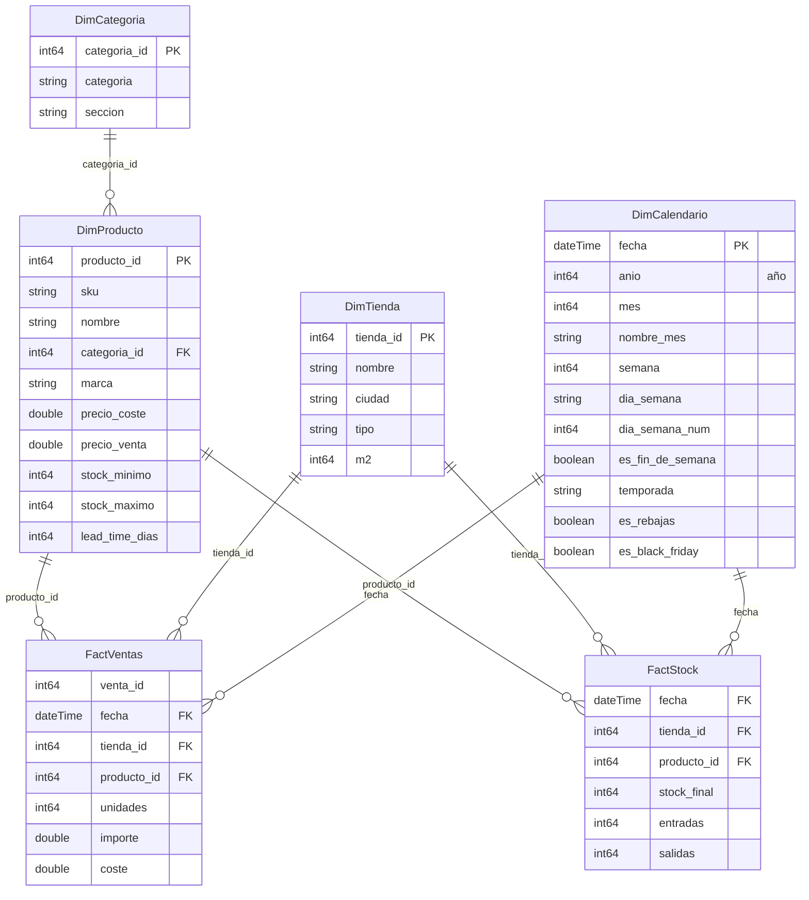

# Modelo de datos

Datos 100% sintéticos de la cadena ficticia SportStock, año 2025 (365 días; no es bisiesto). No describen a ninguna enseña real.

El modelo semántico es una estrella con un copo de nieve de un solo salto: dos hechos al grano fecha-tienda-producto, cuatro dimensiones, y la categoría colgando del producto. Las medidas viven en una tabla vacía, `_Medidas`. Definición en [`../powerbi/RetailStock.SemanticModel/definition/`](../powerbi/RetailStock.SemanticModel/definition/model.tmdl).

## Diagrama

`DimCalendario` está marcada como tabla de fechas (`dataCategory: Time`). La relación `DimProducto` → `DimCategoria` es el único salto fuera de la estrella. Todas las relaciones son 1:* y de una sola dirección.

En el modelo la columna del año se llama `año`. `dia_semana_num` no viene en el CSV: Power Query la calcula (lunes = 1) para ordenar `dia_semana`. Los id de producto, categoría y tienda, y las foráneas de los hechos, van ocultos. La fecha del calendario no: es la clave visible. El informe se filtra por nombre, SKU, ciudad y fecha, no por el id.

## Grano

Los dos hechos comparten el grano fecha-tienda-producto. No hay relación directa entre ellos: se cruzan por las dimensiones.

- **FactVentas** es el agregado diario, no el ticket. Solo entran combinaciones con unidades > 0. La clave de negocio es `(fecha, tienda_id, producto_id)`; `venta_id` es la clave técnica. `importe` ya trae el descuento del día.
- **FactStock** es el snapshot de cierre de cada día, haya venta o no. Una fila por cada referencia y cada fecha: 365 × 200 × 5 = 365.000. La ecuación del generador es `stock_final(d) = stock_final(d-1) + entradas(d) - salidas(d)`.

`unidades`, `importe` y `coste` de ventas se suman en cualquier dimensión, incluida la fecha. `entradas` y `salidas` también: son flujos del día. `stock_final` no. Por eso el stock se lee con medidas, no con la suma implícita de la columna.

## Tablas y origen

Filas contadas en `data/raw/` (sin la cabecera). Cada partición lee `RutaDatos` más el nombre del archivo, en UTF-8.

| Tabla | Filas | CSV | Rol |
| --- | ---: | --- | --- |
| DimCategoria | 8 | [categorias.csv](../data/raw/categorias.csv) | Categoría y sección |
| DimProducto | 200 | [productos.csv](../data/raw/productos.csv) | Ficha: precios, mínimo, máximo, plazo |
| DimTienda | 5 | [tiendas.csv](../data/raw/tiendas.csv) | Tienda, ciudad, tipo, m2 |
| DimCalendario | 365 | [calendario.csv](../data/raw/calendario.csv) | Tabla de fechas |
| FactVentas | 224.317 | [ventas.csv](../data/raw/ventas.csv) | Venta diaria con unidades > 0 |
| FactStock | 365.000 | [stock_diario.csv](../data/raw/stock_diario.csv) | Snapshot diario de las 1.000 referencias |

1.000 referencias = 200 productos × 5 tiendas. El calendario cubre del 2025-01-01 al 2025-12-31.

Power Query declara la fecha como `type date`. TMDL la guarda como `dateTime`, que es el tipo de una columna de fecha en el modelo. Los importes se tipan con cultura `en-US` porque el CSV usa punto decimal. El detalle está en [decisiones.md](decisiones.md).

## Relaciones

Definidas en [`relationships.tmdl`](../powerbi/RetailStock.SemanticModel/definition/relationships.tmdl). Ninguna lleva `crossFilteringBehavior: bothDirections`: son de una dirección. El filtro va del lado uno al lado muchos. Filtrar un hecho no recorta la dimensión y, por tanto, no recorta el otro hecho. Si la dirección fuera doble, una venta filtraría el stock a través del producto y desaparecerían referencias que no vendieron ese día: justo las que la alerta de rotura tiene que ver.

| Relación | Muchos | Uno |
| --- | --- | --- |
| FactVentas_DimCalendario | FactVentas.fecha | DimCalendario.fecha |
| FactVentas_DimTienda | FactVentas.tienda_id | DimTienda.tienda_id |
| FactVentas_DimProducto | FactVentas.producto_id | DimProducto.producto_id |
| FactStock_DimCalendario | FactStock.fecha | DimCalendario.fecha |
| FactStock_DimTienda | FactStock.tienda_id | DimTienda.tienda_id |
| FactStock_DimProducto | FactStock.producto_id | DimProducto.producto_id |
| DimProducto_DimCategoria | DimProducto.categoria_id | DimCategoria.categoria_id |

`DimCalendario[fecha]` es la clave (`isKey`) y la tabla tiene `dataCategory: Time`. Sin eso, `LASTDATE` y `DATEADD` de las medidas no tienen calendario contiguo. `nombre_mes` se ordena por `mes`; `dia_semana`, por `dia_semana_num`.

La categoría no cuelga de los hechos. Un filtro de sección llega a la venta y al stock pasando por el producto. Es un copo de un salto, no una estrella pura: la ficha no repite el nombre de la categoría en cada producto. El mismo diseño está en [`schema.sql`](../sql/schema.sql) (`fk_producto_categoria`).

## Parámetro RutaDatos

La carpeta de los CSV no está escrita en cada tabla. La lee el parámetro `RutaDatos` de [`expressions.tmdl`](../powerbi/RetailStock.SemanticModel/definition/expressions.tmdl). Cómo cambiarla: [configurar_ruta_datos.md](configurar_ruta_datos.md).

## Por qué FactStock es un snapshot semiaditivo

Un snapshot guarda el estado al cierre, no el movimiento. `stock_final` es ese estado: las unidades que hay en la estantería ese día, en esa tienda, de ese producto. `entradas` y `salidas` son el movimiento del día y sí se suman a lo largo del calendario.

`stock_final` es semiaditivo:

- **Se suma entre tiendas y entre productos.** Son unidades distintas que coexisten el mismo día. La suma es el stock de la cadena.
- **No se suma entre fechas.** La misma unidad aparece en cada día que sigue en tienda. Sumar el año la contaría hasta 365 veces. Un periodo no tiene "stock total": tiene un cierre.

Por eso las medidas de stock no hacen `SUM(FactStock[stock_final])` sobre el periodo. `Stock Actual (uds)` y `Valor Stock` se quedan con el último día visible (`LASTDATE`). `Stock Medio` y `Valor Stock Medio` promedian los cierres diarios. El modelo tiene `discourageImplicitMeasures`: el visual no debe usar la suma por defecto de la columna, que está marcada `summarizeBy: sum` solo porque es numérica.

El último día del extracto, y el cierre de esas medidas con el año completo, es el 2025-12-31. El desglose de las medidas está en [medidas_dax.md](medidas_dax.md).
